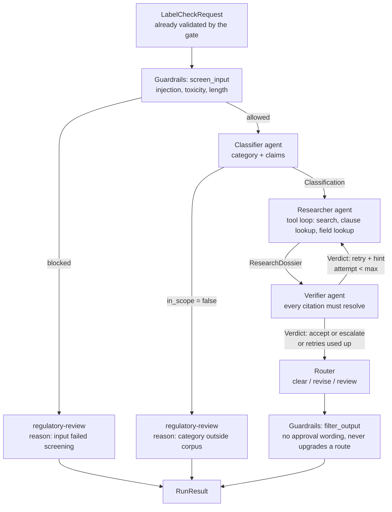

# Agent topology (A2)

Owner: Namith · Requirement: A2 (and the structure behind A1, A3, F7) · Status: draft for Evaluation 1

This page says which agents exist, what each one owns, how they hand work to each other, how the
loop is bounded, and what happens when something fails mid-run. The hand-off types are in
`contracts/fssai_contracts/schemas.py`; the order of steps is fixed by
`contracts/fssai_contracts/pipeline.py` and `LangGraphPipeline` must behave identically at the edges.

## 1. Diagram

Deterministic steps (no LLM decides anything): guardrails, router, and the retry edge. The three
agents are the Classifier, the Researcher and the Verifier.

## 2. The agents

| | Classifier | Researcher | Verifier |
|---|---|---|---|
| Owner | Namith | Namith | Vihaan |
| Package | `libs/agents` | `libs/agents` | `libs/verification` |
| Prompts | `classifier` | `researcher.plan`, `.act`, `.reflect`, `.draft` | its own |
| Input | `LabelCheckRequest` | `Classification` (+ request, + optional `retry_hint` and `previous` dossier) | `ResearchDossier` + request |
| Output | `Classification` | `ResearchDossier` | `Verdict` |
| Tools | none that it chooses (label text is pre-parsed); rule-based fallback | `corpus_search(query, regulation?)`, `clause_lookup(regulation, clause_id)`, `request_field_lookup(path)` | `resolve_citation`, `clause_lookup` |
| State | none between runs | the dossier: passages, queries, findings, escalation signals, attempt number | per-run only |
| Chooses its own tool calls | no | **yes** (LLM picks the tool at each step, or `finish`) | yes |

Why these are agents and not one prompt in one process: each has its own prompt, its own tool set,
its own state, and they only talk through the hand-off schemas above. The Researcher never sees the
Verifier's reasoning, only its `Verdict` (`action`, `retry_hint`, `escalation_reason`). The Verifier
never sees how the Researcher searched, only what it retrieved and cited.

## 3. The Researcher's loop (spec section 5)

Nodes: `plan_queries` → `act` → `observe` → `reflect` → (`act` again, or `draft_findings`).

1. **plan_queries:** from the classification and request, decide which provisions probably apply.
2. **act:** the LLM picks one tool (or `finish`). Arguments are validated against an allowlist
   (regulation must be a known code, `path` must be a field of `LabelCheckRequest`). `ctx.check_budget(tool_call=True)` runs before every call.
3. **observe:** append passages to the dossier and record a `tool` step with the full passages
   (this is what lets a run be rebuilt from its trace, D5).
4. **reflect:** ask "does anything I have read modify, condition or exempt what I found? Which
   regulation would hold it?" Then build the next query from the text just read (a clause
   reference, a defined term, the nutrient and claim named in a table). This is the step a fixed
   pipeline does not have.
5. **draft_findings:** one `Finding` per requirement. Each citation's `quote` must be a verbatim
   substring of a retrieved passage; any that is not is repaired or dropped before returning.
   Conflicts, possible exemptions, a missing condition, or a needed value that is not in the corpus
   go into `escalation_signals`, and the finding is `cannot_determine`.

**Retry mode.** When the Verifier says `retry`, the Researcher receives `retry_hint` and the
`previous` dossier, keeps what was already retrieved, and must change strategy: clause lookup
instead of search, the other regulation, or narrower queries. `attempt` increases by one.

**Nothing from memory.** The agent may not answer from what it "knows" about FSSAI. A requirement
with no supporting retrieved passage is `cannot_determine` plus an escalation signal.

### How this handles the section 4.1 case

- The claim text "source of protein" does not occur in either regulation (Nishkal's passages page).
  A literal match finds nothing, so the Researcher searches by nutrient plus claim level
  ("protein", "source", conditions for nutrient content claims), which reaches FSS-AC-2018
  Schedule I, item 11 and regulation 5(3).
- The Labelling regulation never points to that condition. The step that finds it is `reflect`
  applied to the detected claim ("what regulation conditions a nutrient content claim?"), followed
  by a search restricted to FSS-AC-2018.
- The condition is a percentage of the RDA, and neither regulation states the RDA value. The
  Researcher must not fill it in from training data. Unless the retrieved text supplies the value,
  the finding is `cannot_determine` with an escalation signal naming the missing reference value.
  The agreed handling of this gap is for the team to settle in the Evaluation 1 plan (open
  question in `docs/eval1/section-4.1-passages.md`).

## 4. Loop bounds

All bounds are enforced by `RunContext.check_budget()` and configured in `.env` (`RUN_*`).

| Bound | Default | Env | Where checked |
|---|---|---|---|
| Steps per run (all agents) | 25 | `RUN_MAX_STEPS` | before every step |
| Tool calls per run | 15 | `RUN_MAX_TOOL_CALLS` | before every tool call |
| Wall clock per run | 90 s | `RUN_MAX_WALL_S` | before every step, and the LLM client caps each call by `remaining_s()` |
| Research attempts (Researcher ⇄ Verifier) | 3 | `RUN_MAX_RESEARCH_ATTEMPTS` | the retry edge |
| LangGraph `recursion_limit` | set from `RUN_MAX_STEPS` | derived | graph invocation |

Hitting any bound raises `BudgetExceeded`; the pipeline catches it and returns an **incomplete**
run (see section 5).

## 5. What happens when something fails mid-run

Rule for everything below: a run that did not finish is never returned as a confident answer.
It returns `complete=false`, route `regulatory-review`, and the reason.

| Failure | Detected by | What happens | Result |
|---|---|---|---|
| Input contains an injection or toxic text | `screen_input` | Run stops before any agent starts | `regulatory-review`, flags listed, `complete=true` |
| Category outside the corpus, or label text contradicts the declared category | Classifier `in_scope=false` | No research | `regulatory-review`, category named |
| Classifier LLM returns bad JSON | parse failure | One repair retry, then the rule-based detector answers; rationale says "rule-based fallback" | Run continues, noted in the trace |
| LLM provider down or circuit breaker open, in Classifier | `ProviderUnavailable` | Classifier degrades to rules and the run continues; the Researcher will hit the same outage | See next row |
| LLM provider down or breaker open, in Researcher or Verifier | `ProviderUnavailable` | No further model calls; nothing partial is trusted | `complete=false`, `regulatory-review` (demo item 8) |
| Retriever fails, or the index is missing or empty | exception, or zero passages | Researcher records the tool error; with no passages it cannot ground a finding | `cannot_determine` + escalation signal, so `regulatory-review` |
| A tool call returns nothing useful | empty `passages` | `reflect` changes the query or regulation; repeated misses end in an escalation signal | Escalate, never a guess |
| Researcher produces a citation that is not verbatim | Researcher's own quote check, then Verifier | Repaired or dropped; if the finding loses its support it becomes `cannot_determine` | Verifier `retry` or `escalate` |
| Verifier says `retry` | `Verdict.action` | Researcher re-runs in retry mode with the hint | Up to 3 attempts |
| Still unverified after the last attempt | pipeline | Verdict becomes `escalate` ("still unverified after N attempts") | `regulatory-review` (demo item 6) |
| Step, tool-call or wall-clock bound hit | `BudgetExceeded` | Loop stops where it is | `complete=false`, `regulatory-review` |
| Worker process dies mid-graph | queue job times out | The job is re-queued or marked failed by the worker (Vismay's service). Without checkpointing, the run restarts from the beginning | Run status `failed`, never a half answer. Checkpointing is an extra (see below) |
| Output filter finds approval wording, or a route that its verdict does not support | `filter_output` | Wording blocked; route forced up to `regulatory-review`. It never moves a route toward `clear-for-print` | Safer route than the one proposed |

**Hand-off failure.** If an agent returns something that does not parse as its output schema, that
is treated as the agent failing: Classifier falls back to rules; Researcher or Verifier output that
fails validation counts as an unverified attempt (retry, then escalate).

**Extra (not promised for Evaluation 1):** LangGraph checkpointing in Postgres or Redis so a run
interrupted mid-graph resumes at its last node instead of restarting. If built, this table's
"worker dies" row changes to "resumes".

## 6. What is recorded for every run (D5)

- A `guardrail` step for each screen and each output filter.
- A `classification` step and the classifier's `llm` steps.
- A `tool` step for every Researcher tool call, with the **full passages returned**.
- `llm` steps with prompt name, prompt version, tokens and cost (recorded by the LLM client).
- A `verification` step and a `routing` step.
- `RunResult.prompt_versions` lists the version of every prompt used.

Per-agent Prometheus metrics (A6) are labelled by `agent`: runs and successes, steps and tool calls
per run, per-step and end-to-end latency, retries.

## 7. Open points for the team

1. RDA reference value for nutrient content claims (section 3). Needs a decision before the
   Researcher can reach `met` or `unmet` on the section 4.1 case instead of `cannot_determine`.
2. Whether the Verifier calls `clause_lookup` itself or only resolves citations against the dossier (Vihaan).
3. Whether `recursion_limit` should be per agent or per run.
